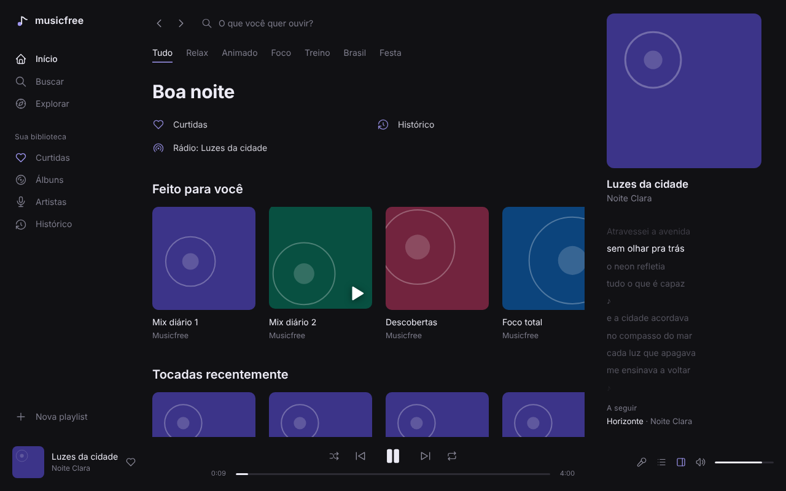
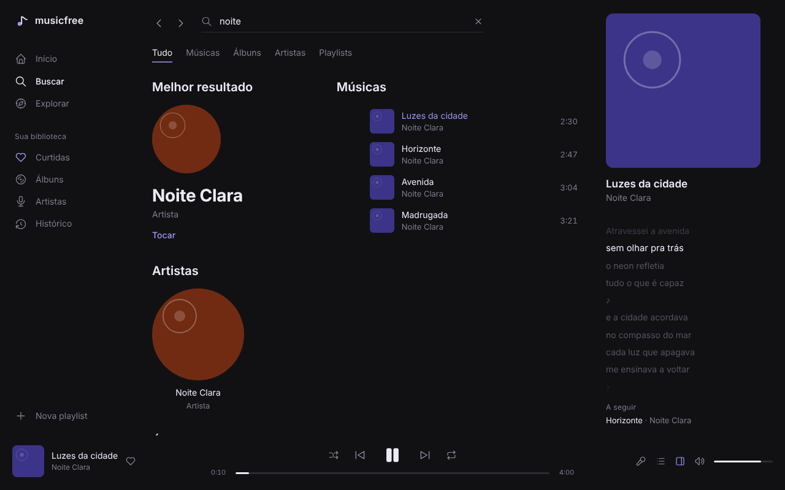
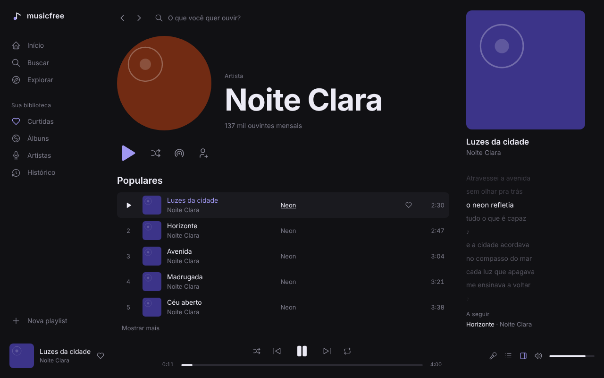
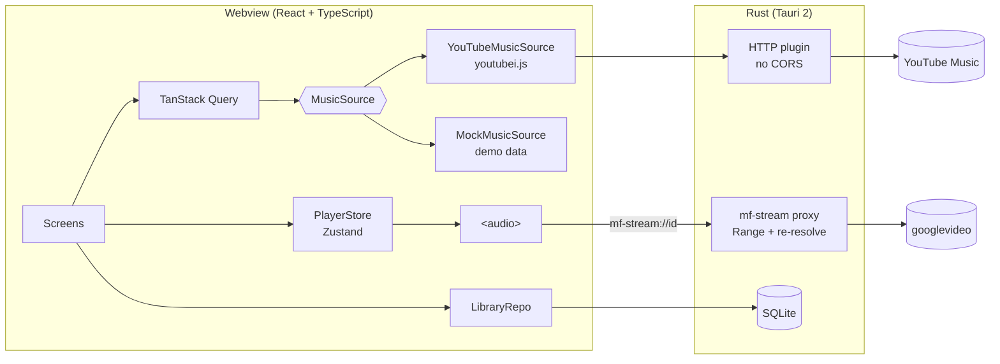

<div align="center">
  
  <h1>Musicfree</h1>
  <p><b>A fast, minimal desktop music player for YouTube Music.</b><br/>Spotify-style experience · lightweight native app · Windows, macOS and Linux</p>

[](https://github.com/chrystianschmith/Musicfree/actions/workflows/ci.yml)
[](https://github.com/chrystianschmith/Musicfree/releases)
[](LICENSE)

[Leia em português](README.pt-BR.md)


</div>

## Features

- **Home with recommendations**: mood filters, mixes, new releases and artists from YouTube Music
- **Search** with live suggestions and tabs for songs, albums, artists and playlists
- **Artist, album and playlist pages** with play, shuffle and start radio
- **Now Playing** view inside the app: big cover art, **synced lyrics** (click a line to jump), queue and related tracks
- **Your library**, stored locally: liked songs, playlists (create, rename, reorder by dragging), saved albums and artists, history
- **Queue**: play next, add to queue, reorder, shuffle, repeat one/all
- **Keyboard and OS media keys**: `Space`, `Ctrl+←/→`, `Ctrl+↑/↓`, `Ctrl+L` (lyrics), `Ctrl+K` or `/` (search), plus media keys and the system media panel
- **Resumes where you left off**: the last queue and position are restored when the app opens (paused)
- Everything runs **inside the app**: no browser windows, no accounts, no ads

| Search                                 | Artist                                 | Now Playing                                     |
| -------------------------------------- | -------------------------------------- | ----------------------------------------------- |
|  |  |  |

> Screenshots use the built-in demo data (fictional artists). The installed app shows real YouTube Music content.

## Download

Get the installer for your system from **[Releases](https://github.com/chrystianschmith/Musicfree/releases)**:

| System                          | File                                                                                        |
| ------------------------------- | ------------------------------------------------------------------------------------------- |
| Windows 10/11                   | `Musicfree_x.y.z_x64-setup.exe`                                                             |
| macOS (Intel and Apple Silicon) | `Musicfree_x.y.z_universal.dmg`                                                             |
| Linux                           | `.deb` (Debian/Ubuntu, ~5 MB) or `.AppImage` (any distro; larger because it bundles WebKit) |

The installers are **not code-signed** (certificates cost money), so the first launch needs one extra click:

- **Windows**: SmartScreen shows "Windows protected your PC" → **More info** → **Run anyway**.
- **macOS**: right-click the app → **Open** → **Open**. If macOS says the app is damaged, run `xattr -cr /Applications/Musicfree.app`.
- **Linux (AppImage)**: `chmod +x Musicfree_*.AppImage` and run it.

## Architecture



- **`MusicSource`** is the only door to YouTube Music. Nothing from `youtubei.js` leaks outside `src/sources/youtube/`, so when YouTube changes something, the fix lives in one folder. A mock source with fictional data powers development, tests and these screenshots.
- **Stream proxy (Rust)**: the `<audio>` element loads `mf-stream://<videoId>`. The proxy forwards `Range` requests in 2 MiB chunks with the right client headers, and when a URL expires or is rejected it asks the front end for a fresh one **once** before skipping the track.
- **Library** lives in SQLite (`tauri-plugin-sql`). The same contract test suite runs against the SQLite repo (via sql.js) and the in-memory repo.
- **Lyrics** come from [LRCLIB](https://lrclib.net) (free, no key) and are cached locally.

## Tech stack

| Layer          | Tools                                                                                               |
| -------------- | --------------------------------------------------------------------------------------------------- |
| Desktop shell  | Tauri 2 (Rust), system webview                                                                      |
| UI             | React 19, TypeScript, Vite, CSS Modules, Tabler Icons                                               |
| State and data | Zustand, TanStack Query                                                                             |
| YouTube Music  | [YouTube.js](https://github.com/LuanRT/YouTube.js) (InnerTube client)                               |
| Storage        | SQLite via tauri-plugin-sql                                                                         |
| Tests          | Vitest, Testing Library, Playwright, cargo test + httpmock                                          |
| CI/CD          | GitHub Actions: lint, tests, e2e, live API smoke test, cross-platform installers on tag, Dependabot |

## Run from source

Requirements: Node 22+, pnpm 10+, Rust (stable) and the [Tauri prerequisites](https://v2.tauri.app/start/prerequisites/) for your OS.

```bash
git clone https://github.com/chrystianschmith/Musicfree.git
cd Musicfree
pnpm install

pnpm tauri dev      # desktop app with real YouTube Music
pnpm dev            # browser-only UI with demo data (http://localhost:1420)
pnpm tauri build    # build the installer for your OS
```

| Command                      | What it does                                       |
| ---------------------------- | -------------------------------------------------- |
| `pnpm test`                  | Unit tests (player, library, mappers, lyrics)      |
| `pnpm e2e`                   | Playwright end-to-end tests against the demo build |
| `pnpm smoke`                 | Live test against the real YouTube Music API       |
| `pnpm lint`                  | ESLint and Prettier                                |
| `pnpm screenshots`           | Regenerates the images in `docs/screenshots`       |
| `cd src-tauri && cargo test` | Rust proxy tests                                   |

Releases are automatic: push a tag such as `v0.2.0` and the `Release` workflow builds the Windows, macOS and Linux installers and publishes them.

## Project layout

```
src/
  app/          layout, sidebar, shortcuts, session restore
  features/     home, search, artist, collection, library, nowplaying, queue, player
  sources/      MusicSource interface, youtube/ (youtubei.js), mock/ (demo data)
  db/           LibraryRepo, SQLite + memory implementations, migrations
  lib/          lyrics (LRCLIB), LRC parser, stream helpers, formatting
src-tauri/      Rust: stream proxy, plugins, commands
e2e/            Playwright tests and screenshot generator
docs/           design spec, implementation plan, screenshots
```

## Disclaimer

Musicfree is an unofficial, personal and educational project. It is not affiliated with, endorsed by, or connected to YouTube or Google. It talks to YouTube's internal (InnerTube) API, which YouTube's Terms of Service do not allow for third-party apps, so use it at your own risk, for personal use only. It is not meant to be published on app stores or monetized. All music belongs to its respective owners.

## License

[MIT](LICENSE) © 2026 Chrystian Schmith
