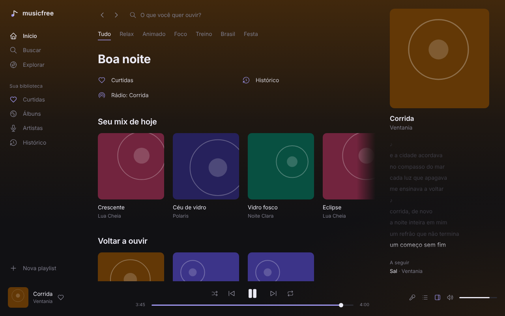

<div align="center">
  
  <h1>Musicfree</h1>
  <p><b>Player de música para desktop, rápido e minimalista, para o YouTube Music.</b><br/>Experiência no estilo Spotify · app nativo e leve · Windows, macOS e Linux</p>

[Read in English](README.md)


</div>

## Funções

- **Recomendações conforme o que você escuta**: mix do dia, "Porque você ouviu…", "Voltar a ouvir" e seus artistas mais tocados, a partir de um perfil de escuta que fica só no seu computador (ouvir até o fim conta a favor, pular logo conta contra)
- **Fila infinita**: quando a fila acaba, músicas parecidas continuam tocando
- **Início**: filtros por clima, mixes, lançamentos e artistas do YouTube Music
- **Design fluido e ambiente**: o app inteiro ganha o tom da capa atual, com transições suaves e barra lateral recolhível
- **Busca** com sugestões enquanto você digita e abas para músicas, álbuns, artistas e playlists
- **Páginas de artista, álbum e playlist** com tocar, aleatório e iniciar rádio
- **Tocando agora** dentro do app: capa grande, **letra sincronizada** (clique num verso para pular até ele), fila e músicas relacionadas
- **Sua biblioteca**, salva no computador: curtidas, playlists (criar, renomear, reordenar arrastando), álbuns e artistas salvos, histórico
- **Fila**: tocar a seguir, adicionar à fila, reordenar, aleatório, repetir uma ou todas
- **Atalhos e teclas de mídia**: `Espaço`, `Ctrl+←/→`, `Ctrl+↑/↓`, `Ctrl+L` (letra), `Ctrl+K` ou `/` (busca), além das teclas de mídia e do painel de mídia do sistema
- **Continua de onde parou**: a última fila e a posição voltam quando você abre o app (pausado)
- Tudo roda **dentro do app**: sem abrir navegador, sem conta, sem anúncios

## Download

Baixe o instalador do seu sistema em **[Releases](https://github.com/chrystianschmith/Musicfree/releases)**:

| Sistema                       | Arquivo                                                                                      |
| ----------------------------- | -------------------------------------------------------------------------------------------- |
| Windows 10/11                 | `Musicfree_x.y.z_x64-setup.exe`                                                              |
| macOS (Intel e Apple Silicon) | `Musicfree_x.y.z_universal.dmg`                                                              |
| Linux                         | `.deb` (Debian/Ubuntu, ~5 MB) ou `.AppImage` (qualquer distro; maior porque inclui o WebKit) |

Os instaladores **não têm assinatura digital**, então a primeira abertura pede um clique a mais:

- **Windows**: o SmartScreen mostra "O Windows protegeu o computador" → **Mais informações** → **Executar assim mesmo**.
- **macOS**: clique com o botão direito no app → **Abrir** → **Abrir**. Se aparecer que o app está danificado, rode `xattr -cr /Applications/Musicfree.app`.
- **Linux (AppImage)**: `chmod +x Musicfree_*.AppImage` e execute.

## Rodar a partir do código

Requisitos: Node 22+, pnpm 10+, Rust (stable) e os [pré-requisitos do Tauri](https://v2.tauri.app/start/prerequisites/) para o seu sistema.

```bash
git clone https://github.com/chrystianschmith/Musicfree.git
cd Musicfree
pnpm install

pnpm tauri dev      # app desktop com o YouTube Music de verdade
pnpm dev            # só a interface no navegador, com dados de demonstração
pnpm tauri build    # gera o instalador do seu sistema
```

Arquitetura, stack, comandos de teste e estrutura do projeto estão no [README em inglês](README.md).

## Aviso

O Musicfree é um projeto não oficial, pessoal e educacional, sem vínculo com o YouTube ou o Google. Ele usa a API interna (InnerTube) do YouTube, o que os Termos de Serviço do YouTube não permitem para apps de terceiros. Use por sua conta e risco, apenas para uso pessoal. O projeto não é feito para ser publicado em lojas nem monetizado. Todas as músicas pertencem aos seus respectivos donos.

## Licença

[MIT](LICENSE) © 2026 Chrystian Schmith
